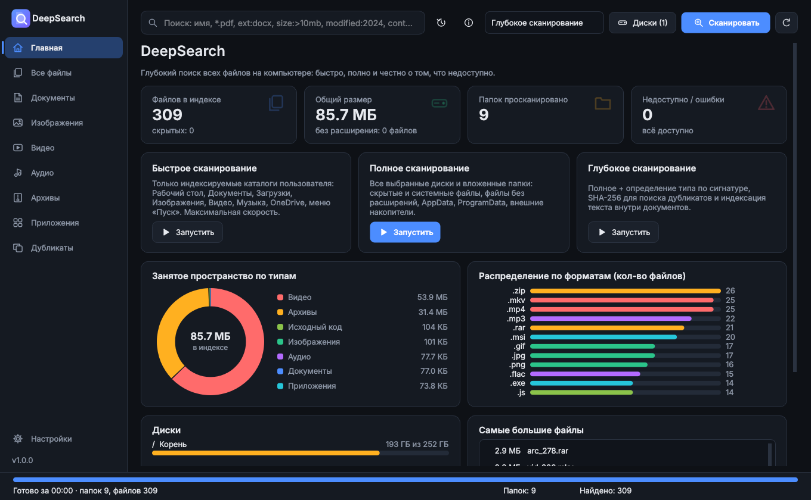

# DeepSearch

Настольное приложение для Windows 10/11, которое строит индекс **всех доступных файлов** на компьютере и
позволяет быстро искать по имени, расширению, размеру, датам, пути и даже по тексту внутри документов.
Программа ничего не удаляет, не переименовывает и не перемещает, а о том, что не удалось прочитать, говорит прямо.

Стек: Python 3.12+, PySide6 (интерфейс), SQLite + FTS5 (индекс), `os.scandir` + Windows API (обход), `hashlib` (SHA-256).



## Быстрый старт

Нужен Python 3.12 или новее ([python.org](https://www.python.org/downloads/), при установке отметьте «Add to PATH»).

**Самый простой способ** — дважды щёлкнуть `run.bat`: он создаст виртуальное окружение, поставит зависимости и запустит программу.

Вручную:

```bash
python -m venv .venv
.venv\Scripts\activate
pip install -r requirements.txt
python main.py
```

Индекс, настройки и журнал лежат в `%LOCALAPPDATA%\DeepSearch\` (`index.db`, `settings.json`, `deepsearch.log`).

## Сборка в EXE

```bash
build_exe.bat              # окружение + зависимости + сборка: dist\DeepSearch\DeepSearch.exe
python build_exe.py --onefile   # один файл dist\DeepSearch.exe (запускается медленнее)
python build_exe.py --admin     # EXE, который при запуске всегда запрашивает UAC
```

Иконка `assets/icon.ico` уже в проекте (пересоздать: `python tools/make_icon.py`).

## Режимы сканирования

| Режим | Что делает |
|---|---|
| **Быстрое** | Только каталоги пользователя, которые Windows обычно индексирует: Рабочий стол, Документы, Загрузки, Изображения, Видео, Музыка, OneDrive, меню «Пуск». Скрытые/системные папки и `node_modules`, `.git` и т. п. пропускаются. Список меняется в «Настройках». |
| **Полное** | Все отмеченные диски (кнопка «Диски») и любые добавленные папки: все вложенные каталоги, скрытые и системные файлы, файлы без расширений, `AppData`, `ProgramData`, внешние накопители. Ничего не исключается, кроме того, что вы сами указали в настройках. |
| **Глубокое** | Полное + (1) определение типа **по сигнатуре** (ловит, например, PNG под именем `.jpg` — фильтр «Тип ≠ расширению»); (2) **SHA-256** для поиска дубликатов; (3) **индексация текста** внутри файлов для поиска `content:…`. |

Остановка — кнопка «Остановить». Прерванное сканирование (в том числе после закрытия программы или сбоя) можно
**продолжить** кнопкой «Продолжить»: очередь необработанных каталогов сохраняется в БД каждые 5 секунд.
Кнопка ⟳ — **обновление индекса**: повторный проход по последним просканированным местам. Он инкрементальный:
у неизменившихся файлов (тот же размер и время изменения) сохраняются хеши, сигнатуры и текст, новые файлы
добавляются, исчезнувшие удаляются. Автообновление при запуске включается в настройках (по умолчанию выключено —
обновление только по запросу пользователя).

## Поиск

Слова через пробел — условие «и». Регистр не важен (в том числе кириллица).

| Запрос | Что находит |
|---|---|
| `отчёт 2024` | имя содержит оба слова |
| `*.pdf`, `report??.*` | шаблоны `*` и `?` по имени |
| `ext:pdf,docx` / `ext:-` | расширение / файлы без расширения |
| `type:изображения\|видео` | тип: документы, изображения, видео, аудио, архивы, приложения, код, системные, временные, без_расширения, скрытые |
| `size:>10mb`, `size:1mb..5mb`, `size:<=500кб` | размер (b, kb, mb, gb, tb, кб, мб, гб) |
| `modified:>2024-01-01`, `modified:2024-05`, `modified:7d`, `modified:today` | дата изменения |
| `created:01.05.2024..31.05.2024` | дата создания |
| `path:"program files"` или `users\anna` | часть полного пути |
| `content:договор аренды` | слова внутри документов (глубокое сканирование); слова ищутся по началу слова, `"в кавычках"` — точная фраза |
| `re:^img_\d+` | регулярное выражение по имени |
| `hidden:yes`, `system:yes`, `temp:yes`, `noext:yes`, `access:no`, `mismatch:yes`, `dup:yes` | атрибуты и состояния |
| `-черновик`, `-ext:tmp`, `-type:системные` | исключения |

Те же условия доступны кнопками под заголовком (тип, размер, дата, «Скрытые», «Системные», «Временные», «Без расширения», «Недоступные», «Тип ≠ расширению»,
«Крупные файлы»). Сортировка — щелчком по заголовку столбца (имя, формат, путь, размер, дата создания/изменения, тип).
История запросов — кнопка ⟲ рядом со строкой поиска (и автодополнение). Результаты можно экспортировать в **CSV** или **JSON**
(потоково — подходит для миллионов записей).

Действия над файлами (двойной щелчок, кнопки или правая кнопка мыши): открыть, показать в Проводнике, скопировать путь,
свойства (в том числе стандартное окно свойств Windows), скопировать файл в буфер обмена или в выбранную папку
(существующие файлы не перезаписываются).

## Дубликаты и большие файлы

Раздел «Дубликаты» показывает группы файлов с одинаковым SHA-256, самые «дорогие» группы — сверху.
Хеши считаются только у файлов с **совпадающим размером** (разные размеры не могут быть дубликатами) —
это на порядки быстрее, чем хешировать всё; полное хеширование включается в настройках. Если глубокое сканирование не
запускалось, нажмите «Найти дубликаты» — хеши будут досчитаны по уже существующему индексу.
Кнопка «Крупные файлы» добавляет `size:>=N` (порог в настройках) и сортирует по размеру.

## Что программа честно НЕ может и как это показывает

* **Нет доступа.** Если Windows запрещает чтение каталога или файла, программа не пытается обойти защиту, а
  записывает причину и идёт дальше. Внизу окна горит «⚠ Недоступно: N» — по щелчку открывается полный список
  (путь, причина, описание) с экспортом в CSV. Для расширения доступа можно перезапустить программу от имени
  администратора (кнопка на главной и в настройках, запрос UAC) — защита системы при этом не отключается.
* **Заблокированные файлы** (открыты другой программой) в глубоком режиме помечаются «Заблокирован» и повторно
  пробуются при следующем сканировании.
* **Файлы «только в облаке»** (OneDrive и др.) попадают в индекс по имени и размеру, но их содержимое **не читается**,
  чтобы не запускать скачивание. Колонка «Доступность»: «Только в облаке».
* **Символические ссылки и junction-точки** не разворачиваются (защита от бесконечных циклов и двойного учёта); их число
  показано внизу. Тома, смонтированные в папку без буквы диска, считаются точкой соединения и тоже не разворачиваются.
* **Отключённые диски.** Список дисков опрашивается каждые 3 секунды: подключение/отключение сообщается внизу, файлы
  отключённого диска помечаются «Диск отключён», пока он не вернётся.
* **Длинные пути** (более 260 символов) поддерживаются через префикс `\\?\`.
* **Текст внутри файлов:** txt/код/html/xml/csv/json…, docx, xlsx, pptx, odt/ods/odp, rtf, pdf (нужен `pypdf`; сканы без
  текстового слоя и зашифрованные PDF не индексируются). Для старых doc/xls/ppt используется упрощённое извлечение строк —
  это эвристика, а не полный разбор формата. Пароль-защищённые документы не читаются. Объём текста на файл ограничен
  (по умолчанию 256 КБ), поэтому содержимое очень больших файлов индексируется только частично.
* Обход основан на `os.scandir`, а не на чтении MFT/USN-журнала NTFS — это не требует прав администратора и не лезет в
  «сырые» тома, но на очень больших дисках первый проход медленнее специализированных утилит. Повторные обновления
  инкрементальны.

## Производительность и устройство

* Результаты **не загружаются в память целиком**: поиск складывает отсортированные id во временную таблицу SQLite,
  а таблица интерфейса подгружает по 200 строк при прокрутке (виртуальная модель). Это работает на миллионах файлов.
* Запись — **пакетная**, одним потоком-писателем (транзакции по ~30 000 строк / 1,5 с, WAL-режим, чтение не блокируется).
* Обход каталогов — пул потоков (по умолчанию 4; настраивается), очередь «в глубину» (остаётся небольшой).
  Опыт показывает: для «тёплого» кэша и быстрых SSD лишние потоки упираются в GIL Python, а для HDD/сетевых дисков
  и «холодного» кэша потоки помогают — поэтому значение можно менять в «Настройках».
* Интерфейс не блокируется: сканирование, поиск, статистика, экспорт, копирование и хеширование идут в фоновых потоках.
* Прогресс в процентах считается по занятому месту на выбранных дисках (для папок — бегущая полоса).

> Замечание о проверке: ядро (сканер, БД, поиск, фильтры, дубликаты, экспорт, возобновление) и интерфейс покрыты
> автотестами, запущенными в Linux (offscreen-режим Qt). Windows-специфичные вызовы (список дисков, атрибуты,
> `\\?\`-пути, Проводник, UAC) реализованы по документации Windows API, но в этой среде сборки их запустить
> было нельзя — при первом запуске на Windows сообщите о любых расхождениях.

## Структура проекта

```
main.py                 запуск приложения, логирование, защита от двойного запуска
scanner.py              многопоточное сканирование, писатель БД, контрольные точки, глубокий анализ
search.py               разбор строки запроса, выполнение поиска, постраничная выдача
filters.py              модель фильтра, разбор размеров/дат, построение SQL
database.py             схема SQLite (+FTS5), соединения, история, ошибки, статистика
duplicate_detector.py   группировка по размеру + SHA-256, сводка по дубликатам
settings.py             настройки (JSON)
filetypes.py            категории, сигнатуры файлов, определение типа
content.py              извлечение текста (txt, docx/xlsx/pptx/odf, pdf, rtf, doc*)
winutils.py             диски, длинные пути, права администратора, действия Проводника
exporter.py             экспорт в CSV/JSON
ui/                     интерфейс: main_window, home_page, results_page, settings_page,
                        dialogs, models, widgets, icons, theme, actions
tools/make_icon.py      генерация assets/icon.ico
tests/                  pytest: ядро и сквозной тест интерфейса
build_exe.py / .bat     сборка EXE (PyInstaller)
```

## Тесты

```bash
pip install -r requirements-build.txt
python -m pytest tests -q
```

Тесты проверяют: полноту обнаружения (скрытые, без расширения, кириллица), циклические симлинки, ошибки доступа с
продолжением обхода, инкрементальное обновление и удаление исчезнувших файлов, остановку и продолжение, сигнатуры и
несовпадение расширений, SHA-256 и дубликаты, поиск по содержимому (txt, docx), синтаксис запросов, сортировку,
постраничную выдачу, экспорт, а также сквозные сценарии интерфейса.

## Лицензия

Проект создан по заданию пользователя; используйте и изменяйте свободно. PySide6 распространяется по LGPL.
